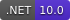
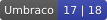

# README and documentation layout

Every AurorisNet repository uses this layout, so a reader who knows one README can find
their way in the next. Write the text itself with the [writing guide](writing-guide.md).

## Who reads it

Developers who install the package, configure it, or work on its source. Write for someone
who knows .NET, and Umbraco where it applies, and is new to this package. Leave out what
the reader can see in the code they are about to write, the history of how the package got
here, and anything the code does not do yet.

Check each statement against the source before keeping it. A README states what the
current code does: the settings it reads, with their defaults, the routes it maps, the
versions its project files accept. Remove a claim the code does not support, and correct a
value that has drifted.

## README sections

Use these sections in this order. Leave out a section the package has no use for, and add
topic sections between **Install** and **Supported versions** when the package needs them.

````markdown
# Package title

One sentence that says what the package does.






Two or three short paragraphs, or a short list, on what the package does and how.

## Install
## Settings
## Supported versions
## Documentation
## Developing
## Releases
## License
````

**Title and opening.** A plain `# Title` heading, then one sentence on what the package
does. Use Markdown only, with no HTML: nuget.org shows the same file and drops HTML.

**Badges.** One line of static badges from [`badges/`](../badges) in this repository:
license, .NET version, and the Umbraco major versions for an Umbraco package. Add a
platform, database or status badge only when it tells the reader something the first
paragraph does not. Make a new badge with `badges/New-Badge.ps1`.

**Hero image.** Optional. Use one when a picture shows the package faster than a paragraph:
a screenshot of the feature in use, or a diagram of the flow it implements. It goes in
`docs/images/hero.png`, at most 1600 pixels wide, with alt text that says what it shows.
A package that changes no screen, such as a startup fix, has no hero image.

**What it does.** State the behavior: what the package registers, changes or adds, and
what the reader sees afterwards. Lead with the capability, as the writing guide describes.

**Install.** The package id, a `PackageReference` or `dotnet add package` line, and what
happens after the site restarts. Say so when the package registers itself.

**Settings.** One table per configuration section, with the setting, its default, and what
it does. Put a warning beside the setting it concerns.

**Supported versions.** A table of the dependency versions the package accepts and the
runtime it needs. An Umbraco package states its releases between markers, which the
release automation rewrites:

```markdown
| Umbraco | Supported releases | Runtime |
|---|---|---|
| 18 | <!-- umbraco-releases 18 -->18.0.0 to 18.3.2<!-- /umbraco-releases --> | .NET 10 |
| 17 | <!-- umbraco-releases 17 -->17.0.0 to 17.8.2<!-- /umbraco-releases --> | .NET 10 |
```

**Documentation.** A table that links each guide in `docs/` with one line on what it
covers. Leave the section out when the README is the whole documentation.

**Developing.** The SDK and tools needed, then one code block with the commands to build,
test and pack. Name the command that runs the full test matrix, which runs on a
developer's machine and never on GitHub.

**Releases.** Three to six lines: the primary dependency the package follows, what starts a
release, how versions are numbered, and a link to the [release guide](releasing.md).

**License.** One line that names the license and links `LICENSE`.

## Links and images

A README that a project packs (`PackageReadmeFile` in its project file) is shown on
nuget.org, where relative links and images break. In those files use absolute links:
`https://github.com/auroris/<repository>/blob/main/<path>` for pages and
`https://raw.githubusercontent.com/auroris/<repository>/main/<path>` for images.
Pages under `docs/` use relative links.

A repository with several packages gives each package a short README of its own in the
project folder: what that package adds, how to install it, and a link to the repository
README for the rest.

## Pages under docs

Start each page with a `# Title` and one or two sentences on the task it supports. Give
each page one purpose: a procedure, a reference, or an explanation. Keep the full
explanation of a subject on one page and link to it from the others. Keep a page's file
name once it is published, because package pages and search results link to it.

Trim a page to what a developer needs to carry out the task or look up the value. Remove
changelog entries, design history, comparisons with earlier versions, and repeated
summaries of other pages.

## Package icons

Every package has an icon: a 128 by 128 PNG with a white glyph on a rounded square of
`#1e293b`, drawn as an SVG beside it. The icon files are `docs/images/icon.svg` and
`docs/images/icon.png`, packed with `PackageIcon`. Packages that ship from one repository
share its icon unless they are separate products. [`icons/`](../icons) has the rules for
the glyph and the command that renders the PNG.
